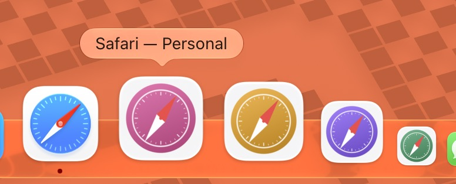
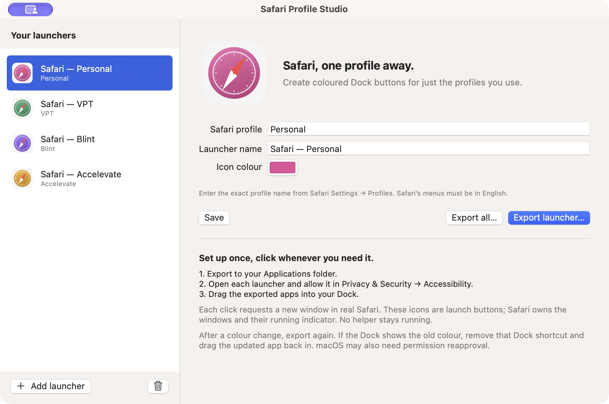

# Safari Profile Launcher

Coloured Dock buttons that open a **new window in a chosen profile in real Safari**. Create only the launchers you want. The native Profile Studio app edits names and colours and exports independent `.app` bundles. No subscriptions, embedded browser, extension, server, or running helper.



## Download

Release downloads are published on [GitHub Releases](https://github.com/torbensko/safari-profiles/releases). The release workflow produces a Developer ID signed and notarized universal macOS app. If no release is listed yet, build from source below.

## Use

1. Open `~/Applications/Safari Profile Studio.app` (or the build in `dist`).
2. Add a launcher. Enter the **exact** profile name from Safari Settings → Profiles, a display name, and a colour. Save.
3. Export to `~/Applications`. Open the exported app once. If permission is missing, choose **Open Permission Settings**, then allow that exported app in System Settings → Privacy & Security → Accessibility. On some macOS releases this is named **Device control and Data access**. Repeat for each launcher. The builder itself does not need permission.
4. Drag the exported applications from Finder into the Dock. Click one to request a new window in its configured profile.



Choose whichever profiles you need and give each a distinct colour. Other Safari profiles do not need a launcher.

These are launch buttons. Safari owns all browser windows, its Command–Tab identity, and its running indicator. Launchers exit after sending their command. A missing/renamed profile produces an error instead of opening a different profile. Existing windows are never closed or repurposed.

## Change an icon or name

Edit the definition, save, and export to the same folder. Confirm the replacement. The bundle ID and existing export path stay stable even after a display-name edit. A UUID suffix is added only if another app already uses the requested filename. Deleting a definition does **not** remove any exported apps.

Icons are persistent ICNS files inside the exported app, with 16–1024 px representations. The colour is not dependent on a running process. Re-export uses a colour-specific icon filename and notifies Finder of the filesystem change. If Finder or the Dock retains the old image, remove that shortcut from the Dock, open the export folder again, and drag the updated app into the Dock. If the OS still caches it, logging out/in may be necessary. The utility never restarts the Dock. See `TESTING.md` for which cache behaviour has actually been verified.

## Permissions and signing

Each exported app is separately ad-hoc signed **after** its executable, definition, icon, and Info.plist are written. Its stable bundle identifier is derived from the definition’s UUID. macOS may invalidate Accessibility trust after a rebuild or re-export; ad-hoc signing does not promise permission persistence. If an allowed app still reports no access, remove the old entry from the permission list, add the exported app at its current path, enable it, and launch again. Do not grant permission to Terminal or Studio as a substitute.

The utility uses Accessibility only, without Apple Events/System Events, shell-generated AppleScript, or profile database access. Accessibility grants broader UI control than this app uses; grant it only to copies you trust. Permission denial gives a single actionable dialog and exits; opening Settings is an explicit button action.

## Build

Requires macOS 13+, Safari with profiles (Safari 17+), English Safari menus, and Xcode Command Line Tools with Swift 5.9 or later. The installed platform verified so far is listed in `TESTING.md`; older versions have not been certified. There are no external packages.

```sh
cd ~/repos/safari-profiles
swift test
./scripts/build.sh
open 'dist/Safari Profile Studio.app'
```

The development build produces a native app for the host architecture. `./scripts/package.sh --unsigned` creates universal DMG/ZIP previews. See [Publishing](docs/releases.md) for the GitHub signing and notarization workflow. Copy the Studio app to `~/Applications` if desired. Exports contain their own copy of `ProfileLauncher`, and continue to work if Studio is closed, moved, or removed. The build script uses the system `codesign`; exports use it too.

For initial setup from a terminal, the built Studio also supports:

```sh
'dist/Safari Profile Studio.app/Contents/MacOS/ProfileStudio' \
  --create 'Personal' 'Safari — Personal' EC4899 "$HOME/Applications"
```

This command never overwrites an existing app. Use the GUI for edits/re-exports. Definitions are saved atomically at `~/Library/Application Support/Safari Profile Launcher/definitions.json`. Back up that file to preserve definition identities. The only other shared file is an advisory launch lock in the same directory.

## How it launches

The installed Safari scripting dictionary exposes no profile command. On Safari 27.2, inspected menu structure is File → New Window → New *profile-name* Window. The implementation traverses the Accessibility File menu recursively and selects exactly one enabled leaf whose full title matches the configured name. `Work` cannot match `Workshop`; names are data, never executable text. English menus are the initial supported language.

Safari is activated or started with NSWorkspace, then its menus are polled for up to 12 seconds, with a one-second AX messaging timeout. Separate launchers serialize menu operations using an advisory lock with a 15-second wait limit. Exactly one AXPress is dispatched per invocation. A dispatch error is never retried because Safari might already have acted. Reopen events while a launcher is busy are queued, but macOS can coalesce very rapid clicks; click again once Safari appears for predictable sequential launches.

Starting Safari can restore its previous session or create its own startup window. This utility does not request a generic/default window and does not close Safari-created startup windows. Testing the closed-Safari path should be done after saving your browser work. A modal Safari dialog can prevent menu access; dismiss it and retry.

Exports are built and signature/icon-validated in a staging folder on the destination volume. Replacement occurs only after success; failure cleans up staging without deleting an existing app. Replacements require confirmation in the UI.

Apple references: [AXUIElementPerformAction](https://developer.apple.com/documentation/applicationservices/1462091-axuielementperformaction) and [AXIsProcessTrustedWithOptions](https://developer.apple.com/documentation/applicationservices/1459186-axisprocesstrustedwithoptions).

## Source layout

- `LauncherCore`: definitions, validation, filenames, exact menu matching.
- `MacSupport`: persistence, Accessibility automation, icon drawing, staged bundle exports.
- `ProfileStudio`: native SwiftUI editor/exporter.
- `ProfileLauncher`: short-lived AppKit launcher and actionable errors.
- `Tests`: pure logic plus macOS store/export integration checks.

`SPEC.md` is the original hand-off. Its Linux/scaffold/location notes describe an earlier session; this implementation was created in the actual `~/repos/safari-profiles` checkout on the Mac. See `TESTING.md` for verification boundaries and remaining manual tests.

## License

ISC. Safari is a trademark of Apple Inc. This utility is an independent project and is not affiliated with Apple.
